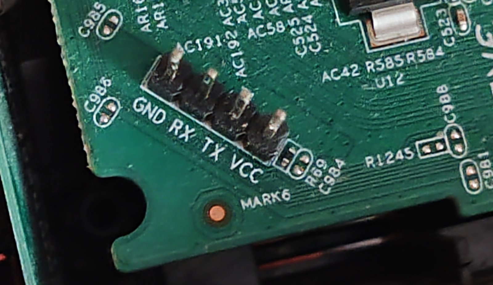

# Установка через UART / Installing over UART

> **RU** ниже, **EN** — в конце.

## ⚠️ Прочитайте до начала

- Прошивка ставится **только через UART и загрузчик Realtek**. Заводской веб-интерфейс
  Ростелекома чужие образы не принимает, sysupgrade из нашей прошивки пока не проверен.
- Нужен разбор корпуса и USB-UART адаптер **3,3 В**. Адаптер на 5 В может сжечь SoC.
- Вы делаете это на свой риск. Гарантия на устройство пропадёт.
- Заводская прошивка во **втором слоте флеша (0x800000) не затирается** — путь назад есть,
  см. [recovery.md](recovery.md).

## Что понадобится

| | |
|---|---|
| USB-UART адаптер 3,3 В | CH340, CP2102, FT232 — любой |
| Провода | 3 штуки: GND, TX, RX |
| Компьютер | Linux (проверено) или Windows/macOS с Python 3 |
| Python 3 + pyserial | `pip install pyserial` |
| Образ | `openwrt-…-electra_rx23302-squashfs-full.bin` из Releases или своей сборки |
| Время | ~45 мин (передача ~27 мин + запись ~13 мин + загрузка и сверка ~5 мин) |

## 1. Подключение UART

Параметры порта: **38400 8N1**, без управления потоком.

**Где UART:** снимите крышку — на плате **торчат 4 штыря**, это и есть UART. Назначение каждого
штыря **подписано на плате**. Паять не нужно, провода с гнёздами (Dupont) надеваются прямо
на штыри. Питание (VCC/3,3 В) **не подключать** — нужны только GND, TX и RX.

Если вывода нет — поменяйте TX и RX местами, ничего не сгорит.



*Слева направо: **GND, RX, TX, VCC**. VCC не подключать.*

Соединение крест-накрест: TX адаптера → RX роутера, RX адаптера → TX роутера, GND → GND.
Питание (VCC) **не подключать**.

Проверка: откройте порт любым терминалом (`picocom -b 38400 /dev/ttyUSB0`), включите роутер —
должен пойти лог загрузки с `Booting...`. Если видите мусор — проверьте скорость 38400.

## 2. Прошивка

Терминал закройте (порт должен быть свободен), затем:

```sh
python3 tools/flash-uart.py openwrt-rtl819x-rtl8197f-electra_rx23302-squashfs-full.bin /dev/ttyUSB0
```

Когда скрипт напишет «жду загрузчик» — **выключите и включите роутер**. Скрипт поймает
приглашение `<RealTek>` (шлёт Esc во время загрузки), затем:

1. передаст образ в ОЗУ по XMODEM (~27 мин);
2. запишет во флеш командой `FLW` (~13 мин, печатаются точки) — **питание не трогать**;
3. дождётся конца записи и напечатает две md5-суммы — по ним флеш сверяется после загрузки (шаг 3).

В конце должно быть `ГОТОВО`.

> Если передача XMODEM оборвалась — флеш ещё не тронут, просто запустите заново.

> Ключ `--flr` добавляет сверку прямо в загрузчике (`FLR` + `CMP`, ещё ~15 мин). По умолчанию
> сверка — из Linux: так быстрее.
>
> Если работаете с загрузчиком руками: на вопрос `(Y)es, (N)o` отвечайте **`Y` и Enter**.
> Без Enter загрузчик молча ждёт бесконечно — выглядит как зависание.

## 3. Первая загрузка

В терминале на 38400:

```
<RealTek>reboot
```

(или просто выключите и включите питание).

После загрузки (~1,5 мин) нажмите Enter и **сверьте флеш** — суммы должны совпасть с теми,
что напечатал `flash-uart.py`:

```sh
md5sum /dev/mtd1
head -c <число из вывода flash-uart.py> /dev/mtd2 | md5sum
```

Не совпали — не продолжайте, прошейте заново. Совпали — **сотрите старые настройки**:

```sh
firstboot -y
```

Затем отдельной командой:

```sh
sync; reboot
```

> Отправляйте команды **по одной и коротко**, подождав ~1 минуту после
> `Please press Enter`: драйвер Wi-Fi при запуске выводит много сообщений, и длинная
> строка может потеряться.

## 4. После установки

Роутер работает как обычный OpenWrt-роутер:

| | |
|---|---|
| LAN | 192.168.0.1, DHCP для клиентов |
| WAN (синее гнездо) | DHCP-клиент |
| Wi-Fi | `RX23302` (2,4 ГГц) и `RX23302-5G`, пароль **1234567890** — смените! |
| Веб | LuCI: <http://192.168.0.1>, пользователь `root`, пароля нет — задайте при первом входе |
| SSH | `ssh root@192.168.0.1` |

Гнёзда: **синее = WAN**, **жёлтые = LAN1, LAN2**.

---

## English

**Read first.** Installation is **only via UART and the Realtek bootloader**. You need to open
the case and use a **3.3 V** USB-UART adapter. The stock firmware in the **second flash slot
(0x800000) is not overwritten**, see [recovery.md](recovery.md). At your own risk.

**Serial:** 38400 8N1, no flow control. Remove the cover: the UART is the **4-pin header**
on the board, each pin is labelled on the PCB. No soldering, Dupont wires
fit. GND–GND, adapter TX → router RX, adapter RX → router TX, do not connect VCC. No output —
swap TX/RX, nothing breaks.


*Left to right: **GND, RX, TX, VCC**. Leave VCC unconnected.*

**Flash:**

```sh
pip install pyserial
python3 tools/flash-uart.py <full.bin> /dev/ttyUSB0
```

Power-cycle the router when asked. The script catches the `<RealTek>` prompt, sends the image
over XMODEM (~27 min), writes it with `FLW` (~13 min, do not cut power) and prints two md5 sums
for verification after boot. `--flr` adds an in-bootloader read-back (`FLR` + `CMP`, ~15 min more); verifying from Linux is
faster, so it is off by default. Manual bootloader use: answer `(Y)es, (N)o` with **`Y` and
Enter** — without Enter it silently waits forever and looks hung.

**First boot:** `reboot` at the `<RealTek>` prompt (or power-cycle); after boot check
`md5sum /dev/mtd1` and `head -c <N> /dev/mtd2 | md5sum` against the sums printed by the script,
then run `firstboot -y`, then
`sync; reboot` — as separate short commands, about a minute after `Please press Enter`.

**Defaults:** LAN 192.168.0.1 (DHCP server), WAN = blue port (DHCP client), Wi-Fi `RX23302` /
`RX23302-5G` with password `1234567890` (change it), LuCI at http://192.168.0.1, user `root`,
no password until you set one.
